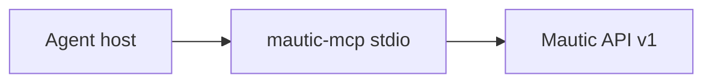

# 05 — Architecture

> **Gate:** `status: approved` required before epics, versions, and user stories in SQLite.

## Objective

Local stdio MCP server for a self-hosted Mautic. The agent reads and, in `operate` mode, creates, updates and deletes contacts, campaigns, emails, segments, forms, companies, categories, pages, assets, focus items, points, stages, tags and reports. Tool catalog, write bodies and gates are in `docs/architecture/mcp.md`.

Out of this server: its own database, a UI, the projects API v2, file upload, campaign execution and sending an email to a whole segment.

## System context



The agent host starts the process, which reads credentials only from the environment and calls `https` (or `http` on localhost). It does not open a port.

**Repository layout (high level):**

```txt
server/
  src/config.ts              # environment and policy
  src/auth.ts                # Basic and OAuth2 client_credentials
  src/http.ts                # fetch with timeout
  src/server.ts              # stdio and tool registration
  src/mautic/                # client, catalog, writes, summary
  src/tools/                 # one function per tool
  docs/05_architecture.md
  docs/architecture/mcp.md
```

## Layers and boundaries

| Layer | Responsibility | Paths | Depends on |
| ----- | -------------- | ----- | ---------- |
| Entry | Validates the environment, starts stdio, registers only the tools allowed by policy | `src/server.ts`, `src/config.ts`, `src/policy.ts` | Tools |
| Tools | One action per tool. Turns arguments into a domain call | `src/tools/` | Gateway, writes, summary |
| Mautic domain | Catalog, paths, create/update body, summary | `src/mautic/` | Gateway |
| Access | HTTP, auth, retry, secret redaction | `src/http.ts`, `src/auth.ts`, `src/mautic/client.ts` | no tool |

A tool does not build a free-form URL. `src/mautic/paths.ts` is the only route list.

## Major components

| Component | Purpose | Tech | Owner module |
| --------- | ------- | ---- | -------------- |
| McpServer | Exposes tools and one campaign prompt | `@modelcontextprotocol/sdk` stdio | `src/server.ts` |
| MauticClient | GET/POST/PATCH/PUT/DELETE on API v1 | `fetch` | `src/mautic/client.ts` |
| AuthProvider | Authorization header | Basic or OAuth2 form body | `src/auth.ts` |
| Write model | Campaign and email rules, publish defaults | TypeScript | `src/mautic/write-model.ts` |
| Presenter | Short JSON, no HTML on search, no secrets | TypeScript | `src/mautic/present.ts` |

## Integration points

| System | Direction | Protocol | Auth | Failure mode |
| ------ | --------- | -------- | ---- | ------------ |
| Agent host | inbound | MCP stdio | local process | tool absent when policy disables it |
| Mautic API v1 | outbound | HTTPS JSON | Basic or OAuth2 `client_credentials` | 10s timeout; one retry on GET 429/503; POST is not retried; 401 refreshes the token once |

`MAUTIC_BASE_URL` is the site origin, with or without a trailing `/api`. `http` is allowed only on `localhost` or `127.0.0.1`.

## Key flows

### Flow 1 — read

1. The agent calls `mautic_search` or `mautic_get`.
2. The client builds Basic auth or fetches a token, calls the catalog path and summarizes the entity.
3. Search returns at most 25 items, without `customHtml`. Getting a report executes it and returns at most 25 rows.

### Flow 2 — create a campaign without sending

1. With `MAUTIC_MODE=operate`, the agent creates the segment, the email and the campaign.
2. The campaign and the email are unpublished when `isPublished` is omitted.
3. A campaign requires `events` and `lists` or `forms`. Without `canvasSettings`, the server builds a linear flow.
4. `mautic_send_email` exists only with `MAUTIC_ALLOW_SEND=true` and sends to one contact. `mautic_delete` exists when `MAUTIC_ALLOW_DELETE=true`.

## Architecture detail files

| File | Topic | Status |
| ---- | ----- | ------ |
| `docs/architecture/mcp.md` | Tools, policy, bodies and what the server refuses | draft |

## Cross-cutting concerns

| Concern | Approach | Doc ref |
| ------- | -------- | ------- |
| Auth | Credentials only in env. Responses and logs carry no password or token | `docs/architecture/mcp.md` |
| Logging | stderr: tool, resource, id, status. No body and no email | `src/audit.ts` |
| Feature flags | `MAUTIC_MODE`, `MAUTIC_ALLOW_DELETE`, `MAUTIC_ALLOW_SEND` | `src/policy.ts` |
| Secrets | A secret substring of 8+ characters is replaced with `[redacted]` in error messages | `src/redact.ts` |

## Mode B — as-is vs target

| Area | Current (evidence) | Target (if migrating) |
| ---- | ------------------ | --------------------- |
| Product | Repository had no product code before this server | This MCP is the product |

## Gaps / open questions

| # | Gap | Blocks backlog |
| - | --- | -------------- |
| 1 | This document stays `draft` until a human approves it | yes |
| 2 | Docs `00` through `04` and `02_security` do not exist yet | no |
| 3 | Tests cover the client, policy and bodies. They do not call a live Mautic | no |

## Gate

Only **human** sets `status: approved`. Run `/architecture` before approval.
